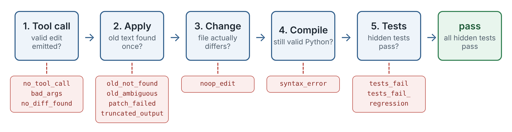
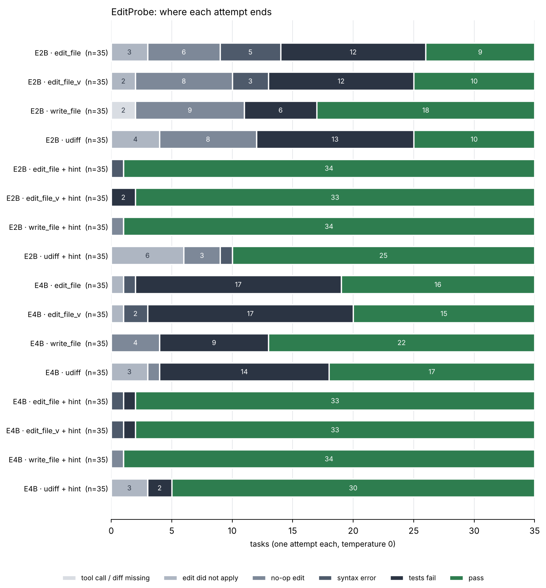

**Author:** Khrystyna Didukh (Vienna). Code, tasks and logs: <https://github.com/khrisdidukh/editprobe-gemma4>, Apache-2.0.

## Abstract

Small open models fail most bug-fixing tasks in the Gemma 4 Developer Agent competition, but it is unclear which step fails. EditProbe is a 35-task diagnostic that hands the model the one buggy file (18–97 lines) and scores the edit it makes under the competition's tool semantics, with hidden tests as the judge. On two CPU cores with Gemma 4 E2B and E4B across four edit protocols: given the fix in words, both models land it in 94–97% of tasks. Without the hint they resolve 26–51% (E2B) and 43–63% (E4B). E2B loses tasks to no-op edits and duplicated code; E4B's edits are clean but often change the wrong lines. In both models, an edit that misses the buggy lines almost never passes. Whole-file rewrites beat `edit_file` for both sizes.

## 1. Introduction

The Gemma 4 Developer Agent competition asks for an offline agent that fixes bugs in Python repositories. The agent changes code through `edit_file(filepath, old_string, new_string)` or `write_file(filepath, content)`, and hidden tests decide.

On 104 public tasks, Gemma 4 E4B resolved 10–15% (Toeda, 2026), while the gold patches are small: median 12 changed lines, mostly in one file (Fearoff5214, 2026).

This note isolates the last two steps. The model sees the one file that contains the bug (18–97 lines), and I ask whether its edit (a) is a valid tool call, (b) matches the file, (c) leaves valid Python, (d) fixes the bug without breaking other tests. I also give the model the gold fix in words, to separate “cannot land an edit” from “cannot find the fix”.

Contributions:

1.  **EditProbe**, 35 single-file tasks from the competition’s dev-set repositories (requests, rich, httpx), with user-style problem statements, 1–5 line gold fixes and hidden tests.
2.  A harness that drives Gemma 4 through native tool calls and applies edits with a reimplementation of the competition’s `edit_file` matcher.
3.  Measurements for E2B and E4B across four edit protocols, with and without the fix as a hint.
4.  A named failure mode, **span mismatch**, and a harness-side repair for it.

### 1.1 Why this question

Why do I do this? Because right now, in the world of artificial intelligence, very few people optimise their spending on AI. And also too few people think about privacy. That is why this task was interesting for me: a small task that can help with many things.

For example, when code cannot be sent to the cloud. This is first of all defense, then banks, medicine, corporations that have no right to send their code to ChatGPT or Claude. They need small local models, like these E2B and E4B, which work on two processor cores, on an ordinary server or a laptop without an expensive graphics card.

This task is also important for those who build agents on small models. What I found (more on this below) is that the format of the edit is not the main thing. The main thing is that the model correctly finds which lines to change. And this saves weeks of work on unnecessary things. Also, a small local model can solve half of the simple bugs practically for free (here, with the buggy file already given). So we run it first and leave the big models for the more complex cases. It is also important that this paper shows at which step the agent breaks. And this way of analysis can be applied to any agent, not only for code.

My main human conclusion is that a small offline model already knows how to make edits. It lacks only the skill to find where exactly the error is. And this is a real hint for everyone who wants their own AI programmer without the cloud.

My work experience regarding this matter is totally under the NDA, so this paper uses only public data and the benchmark described here.

## 2. Related work

**Bug-fixing agents.** SWE-bench (Jimenez et al., 2024) set the format the competition uses. SWE-agent (Yang et al., 2024) showed that how files are viewed and edited moves success rates for the same model. Agentless (Xia et al., 2024) splits the work into localization, repair and validation; OpenHands (Wang et al., 2024) is the common open framework. My tasks sit at the repair end, with the file given.

**Edit formats.** Aider (Gauthier, 2023) found that unified diffs reduced “lazy” rewrites of GPT-4 Turbo. Diff-XYZ (Glukhov et al., 2025) reports that the best diff format depends on model size and that small open models score near zero. I ask the same question for two small Gemma 4 sizes under the competition’s tool semantics, with tests as the judge.

**Synthetic bugs and Gemma 4.** SWE-smith (Yang et al., 2025) and HumanEvalFix (Muennighoff et al., 2023) inject bugs into real code. Toeda (2026) measured scaffold effects for Gemma 4 on the public tasks, and Gemma4_paper_track (2026) found that tool-call loops often sit on failing edits. I measure the failing edits themselves.

## 3. EditProbe

### 3.1 Tasks

Each task is a directory with `src.py` (buggy module), `gold.py`, hidden `test_task.py` and `task.json` (problem statement, source, gold region). To build one I took a function or small class from requests, rich or httpx (14 modules, e.g. `requests/utils.py`, `rich/cells.py`, `httpx/_urlparse.py`), made it standalone, wrote 4–5 pytest tests, and injected one bug as a string replacement: off-by-one, dropped `.lower()`, wrong constant, missing `max(...)`, removed branch, wrong regex, inverted condition. The reversed mutation is the gold fix. The problem statement reads like a user report (observed vs expected output), never naming the line or the fix. Licenses (Apache-2.0, MIT, BSD-3) are in `NOTICE`.

`bench/build_tasks.py` refuses any task where the gold module fails a test, the buggy module passes all tests, or the mutation is not unique.

|                   |                                                |
|:------------------|:-----------------------------------------------|
| tasks             | 35 (12 requests, 11 rich, 12 httpx)            |
| module length     | median 47 lines (18–97)                        |
| gold fix          | 1 line in 32 tasks, 2 lines in 1, 5 lines in 2 |
| problem statement | median 258 characters                          |
| tests             | 51 FAIL_TO_PASS, 92 PASS_TO_PASS in total      |

### 3.2 Protocols

The model gets one system message and one user message: problem statement, the whole `src.py` in a code block, an optional hint, and one instruction line. Four protocols:

| protocol      | model output                                                                     | how it is applied             |
|:--------------|:---------------------------------------------------------------------------------|:------------------------------|
| `edit_file`   | native tool call `edit_file(filepath, old_string, new_string)`                   | three-tier matcher (below)    |
| `edit_file_v` | same, with an instruction to copy `old_string` verbatim with ≥2 lines of context | same                          |
| `write_file`  | native tool call `write_file(filepath, content)`                                 | file replaced                 |
| `udiff`       | unified diff in a fenced block, no tools                                         | `git apply`, then `patch -F3` |

The **hint** condition appends the gold fix in words: "The bug is in these lines: ‹buggy lines›. They should become: ‹gold lines›". With the hint, the task is pure transcription into an edit.

### 3.3 Matcher

The competition README says `edit_file` tries an exact match, then a whitespace-flexible match, then a regex match, and fails when more than one place matches. `harness/matcher.py` is my reading of that: exact substring, then the same tokens with any whitespace between them, then `old_string` as a Python regex; each tier requires a unique match. Every applied edit is tagged with its tier.

### 3.4 Failure ladder

Each attempt ends at exactly one stage (Figure 1).

<figure>

<figcaption aria-hidden="true">Figure 1. The failure ladder.</figcaption>
</figure>

Figure 1. The failure ladder. Every attempt stops at the first stage it fails; the red boxes are the stage labels used in the result tables. `tests_fail_regression` means FAIL_TO_PASS fixed but a PASS_TO_PASS broken.

### 3.5 Setup

llama.cpp commit 954de24 (6 Nov 2026), CPU build; `llama-server --jinja`, 2 threads, context 8192 (6144 for part of the E4B runs; prompts are under 1k tokens). Models: the official QAT checkpoints `google/gemma-4-E2B-it-qat-q4_0-gguf` and `google/gemma-4-E4B-it-qat-q4_0-gguf`. Temperature 0, thinking off, one attempt per task, `max_tokens` 1200 (3000 for `write_file`). `pass` follows the competition rule: every FAIL_TO_PASS and PASS_TO_PASS test passes.

Machine: 2 vCPU, 7.8 GB RAM, no GPU, weaker than most laptops, so anyone can rerun the grid for free.

## 4. Results

Raw records are in `results/*.jsonl`.

### 4.1 Gemma 4 E2B

**Table 1. E2B by protocol, without and with the gold fix as a hint.** "applied" = the edit reached the file; "resolved" = all hidden tests pass (bootstrap 95% CI over tasks).

| protocol           | applied | compiles | resolved     | 95% CI  | == gold | mean tokens out |
|:-------------------|:--------|:---------|:-------------|:--------|:--------|:----------------|
| edit_file          | 32      | 27       | **9 (26%)**  | 11–40%  | 3       | 210             |
| edit_file_v        | 33      | 30       | **10 (29%)** | 14–46%  | 5       | 192             |
| udiff              | 31      | 31       | **10 (29%)** | 14–43%  | 6       | 156             |
| write_file         | 33      | 33       | **18 (51%)** | 34–69%  | 9       | 481             |
| edit_file + hint   | 35      | 34       | **34 (97%)** | 91–100% | 34      | 75              |
| edit_file_v + hint | 35      | 35       | **33 (94%)** | 86–100% | 32      | 75              |
| udiff + hint       | 29      | 28       | **25 (71%)** | 57–86%  | 22      | 116             |
| write_file + hint  | 35      | 35       | **34 (97%)** | 91–100% | 31      | 475             |

**Landing an edit is not E2B's problem.** Given the fix in words, `edit_file` passes in 34 of 35 tasks, all 34 byte-identical to the gold file, and every `old_string` matched at the exact tier: the whitespace-flexible and regex tiers were never needed. Unified diffs are weak even for transcription: 6 of 35 did not apply and 3 changed nothing.

**Without the hint, the protocol changes the outcome by a factor of two.** `write_file` resolves 18 tasks, search/replace 9–10, unified diff 10. The union over the four protocols is 21 tasks; only 4 are solved by all four. `write_file` costs 2.3× the output tokens of `edit_file` and did not damage files: mean 0.5 changed lines outside the gold region (max 4).

<figure>

<figcaption aria-hidden="true">Figure 2. Where attempts end, per model and condition.</figcaption>
</figure>

Figure 2. Where attempts end, per model and condition.

Figure 2 shows three E2B failure modes.

*No-op edits.* In 6–9 tasks per protocol the model emits a valid edit that changes nothing: `new_string == old_string`, a rewrite identical to the input, or a diff whose `+` and `-` lines are equal. One task (`rich_filesize_decimal`) is a no-op under all four protocols. An agent loop that only checks for errors sees progress.

*Span mismatch.* All 5 syntax errors in `edit_file` and all 3 in `edit_file_v` have one shape: `new_string` repeats 2–20 lines that sit before or after `old_string`, so the replacement duplicates them. A harness-side **anchor repair** (when the plain replacement does not compile, extend the replaced region to the first and last lines of `new_string` if each occurs once within 80 lines), replayed on the logged edits, makes 3 of 4 repairable edits compile and raises E2B `edit_file` from 9 to 10. It never touches an edit that compiles, so it cannot lower the score; for E4B, which rarely makes this mistake, it changes nothing.

*Hallucinated* `old_string`*.* 5 edits across the two search/replace protocols did not match because the model renamed an identifier while copying (`HEADER_VALIDATORS` → `_HEADER_VALIDATORS`). The flexible matcher tiers cannot rescue these.

### 4.2 Gemma 4 E4B

**Table 2. E4B, same protocols.**

| protocol           | applied | compiles | resolved     | 95% CI  | == gold | mean tokens out |
|:-------------------|:--------|:---------|:-------------|:--------|:--------|:----------------|
| edit_file          | 34      | 33       | **16 (46%)** | 29–63%  | 13      | 113             |
| edit_file_v        | 34      | 32       | **15 (43%)** | 26–60%  | 11      | 117             |
| udiff              | 32      | 32       | **17 (49%)** | 31–66%  | 14      | 149             |
| write_file         | 35      | 35       | **22 (63%)** | 46–80%  | 8       | 510             |
| edit_file + hint   | 35      | 34       | **33 (94%)** | 86–100% | 32      | 68              |
| edit_file_v + hint | 35      | 34       | **33 (94%)** | 86–100% | 31      | 70              |
| udiff + hint       | 32      | 32       | **30 (86%)** | 74–97%  | 25      | 115             |
| write_file + hint  | 35      | 35       | **34 (97%)** | 91–100% | 28      | 474             |

**E4B fixes the mechanics, not the diagnosis.** No-op edits almost disappear (0 in `edit_file`, against 6 for E2B), syntax errors drop to 1–2, and unified diffs apply in 32 of 35 tasks, with or without the hint. Resolution rises to 43–63% and the four protocols agree far more: 12 tasks are solved by all four (E2B: 4), 23 by at least one. The dominant failure is now `tests_fail`, a clean compiling edit with the wrong lines or logic: 16 of 35 for `edit_file`. `write_file` is still the best protocol without a hint, but its lead over `edit_file` shrinks from 2× to 1.4×. The verbatim-copy instruction (`edit_file_v`) helps neither model.

**Localization separates success from failure in both models.** I check whether an applied edit's removed lines intersect the buggy lines:

| condition      | applied | touched gold lines | resolved if touched | resolved if not |
|:---------------|:--------|:-------------------|:--------------------|:----------------|
| E2B edit_file  | 32      | 14                 | 7/14                | 2/18            |
| E2B write_file | 33      | 21                 | 17/21               | 1/12            |
| E4B edit_file  | 34      | 22                 | 15/22               | 1/12            |
| E4B write_file | 35      | 24                 | 21/24               | 1/11            |

Across the four rows, edits that miss the buggy lines pass 5 times in 53 attempts. E4B localizes better than E2B (22 vs 14 of the applied `edit_file` edits), and that is most of its gain. Nine tasks were never solved without the hint by either model under any protocol; with the hint, every task is solved by both.

### 4.3 One task up close

Task `httpx_normalize_port` shows the main pattern in one place. The module keeps a table of default ports, and the bug is a typo: `"https": 433` instead of `443`. The problem statement only says that `normalize_port("443", "https")` returns `443` instead of `None`.

- **E2B, `edit_file` and `edit_file_v`:** an edit whose `old_string` and `new_string` are the same four lines of the comparison function. It applies without error and changes nothing.
- **E2B, `udiff`:** rewrites the last line of that function into `return port_as_int if port_as_int != default_port else None`. It applies and compiles; the tests still fail.
- **E4B, `edit_file`:** replaces `433` with `443`, the gold fix.
- **E2B, `write_file`:** the same small model returns exactly the gold file. One possible reason: retyping a familiar table, it restores the value it has seen many times. I did not test this.

E2B’s search/replace edits went to code close to the bug in meaning but not in place: the localization failure in its simplest form.

### 4.4 Cost

The full grid (560 attempts) took 1.8 hours for E2B and 7.9 hours for E4B on two CPU cores (inflated by machine load and restarts). Nothing is gated or paid.

## 5. What this means for an agent built on E2B/E4B

1.  **Spend tokens on localization, not on edit formats.** With the fix known, both models land it in 94–97% of tasks for about 70 output tokens. Without it, an edit that misses the buggy lines almost never passes. An agent should first make the model name the lines it will change, and check them.
2.  **For files that fit in one** `read_file` **window, consider** `write_file`**.** It led for both sizes here (51% vs 26% on E2B, 63% vs 46% on E4B) at 2.3–4.5× the output tokens. The intervals overlap for E4B.
3.  **Report no-op edits back to the model.** A string compare before and after the edit is free and would have flagged 17–26% of E2B's edits.
4.  **Add anchor repair to** `edit_file` **if you run E2B.** It acts only when the plain edit does not compile.
5.  **Do not ask E2B for unified diffs.** Even with the exact fix, 10 of 35 failed to land or changed nothing. E4B handles diffs well.

## 6. Limitations

- 35 tasks, one attempt each at temperature 0: intervals are wide, and differences of a few tasks are not evidence.
- Bugs are injected mutations in standalone code; real issues are longer and files larger.
- The matcher is reimplemented from the README; q4_0 GGUF and llama.cpp’s tool-call parser differ from the competition’s w4a16 checkpoints on vLLM. Thinking was off.
- I wrote all tasks before any model run; none was changed after seeing results.

## 7. Future work

- **Real issues:** the same ladder on the public dev-set tasks, where the agent must find the file itself.
- **A localization step:** make the model name the lines it will change, check them against the failing test, then edit, and measure how much of the hint gap this closes.
- **Thinking and larger sizes:** thinking on, sampling, and Gemma 4 12B and 26B-A4B.

## References

- Jimenez et al. (2024). SWE-bench. ICLR 2024. arXiv:2310.06770.
- Yang et al. (2024). SWE-agent. NeurIPS 2024. arXiv:2405.15793.
- Xia et al. (2024). Agentless. arXiv:2407.01489.
- Wang et al. (2024). OpenHands. arXiv:2407.16741.
- Gauthier (2023). Unified diffs make GPT-4 Turbo 3X less lazy. <https://aider.chat/docs/unified-diffs.html>
- Glukhov et al. (2025). Diff-XYZ. arXiv:2510.12487.
- Yang et al. (2025). SWE-smith. arXiv:2504.21798.
- Muennighoff et al. (2023). OctoPack (HumanEvalFix). arXiv:2308.07124.
- Toeda (2026). Scaffolding Helps the Smallest Gemma 4 Agent, Not the Larger Ones. doi:10.5281/zenodo.23834104.
- Gemma4_paper_track (2026). <https://github.com/usp787/Gemma4_paper_track>
- Fearoff5214 (2026). <https://github.com/Fearoff5214/Gemma_4_Kaggle_hackathon>
- ggml-org (2026). llama.cpp. <https://github.com/ggml-org/llama.cpp>
